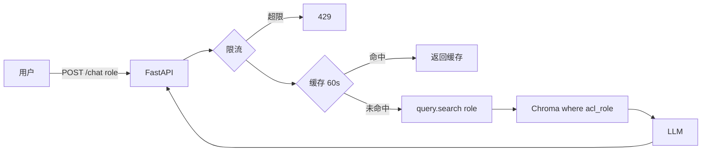

# 企业知识库权限 Agent（带 ACL 的 RAG）

同一套 RAG，加上部门权限：**检索层按角色过滤**，越权问题直接拒答；带限流、缓存与失败降级。

## 角色与权限

| 角色 | 可见文档 |
| --- | --- |
| `guest` | public |
| `hr` | public + hr |
| `finance` | public + finance |
| `engineering` | public + engineering |
| `admin` | 全部 |

## 架构



## 快速开始

```bash
python -m venv .venv
source .venv/Scripts/activate
pip install -r requirements.txt
cp .env.example .env          # 填 4 个变量

python scripts/seed_corpus.py  # 生成 8 篇示例语料（分 4 个部门）
python ingest.py               # 建索引，写入 ACL 字段
uvicorn app:app --port 8010

curl http://127.0.0.1:8010/roles
curl -X POST http://127.0.0.1:8010/chat \
  -H "Content-Type: application/json" \
  -d '{"question":"公司每年调薪幅度多少","role":"hr"}'
```

## 评测

12 条：6 条权限内、3 条越权、3 条公共。

| 指标 | 数值 |
| --- | --- |
| 权限内命中率 | 1.00 |
| 越权拒答率 | 1.00 |
| 公共命中率 | 1.00 |
| 权限违规数 | 0 |

运行 `python eval/eval.py`，明细在 `eval/runs/before.json`（不进 git）。

## 设计取舍

- **权限放在检索层**，不是 prompt 里说「不要回答」。后者靠模型自觉，前者是 Chroma `where` 硬过滤。
- ACL 用布尔字段 `acl_<dept>`，因为 Chroma metadata 不支持数组；查询用 `$or: [acl_public, acl_<role>]`。
- 成本控制：每角色 20 次/分钟限流、60 秒答案缓存、上下文最多 5 段 × 400 字。
- 失败降级：检索/生成异常返回 503 + 可读原因，不把 traceback 甩给用户。

## 已知限制

- 限流与缓存是单机内存，多实例不共享（生产要换 Redis）。
- 角色写死在代码里，未接 SSO / JWT。
- ACL 只到部门级，未做到文档级或字段级。
- 语料是示例数据，用于演示权限边界。

## License

MIT
